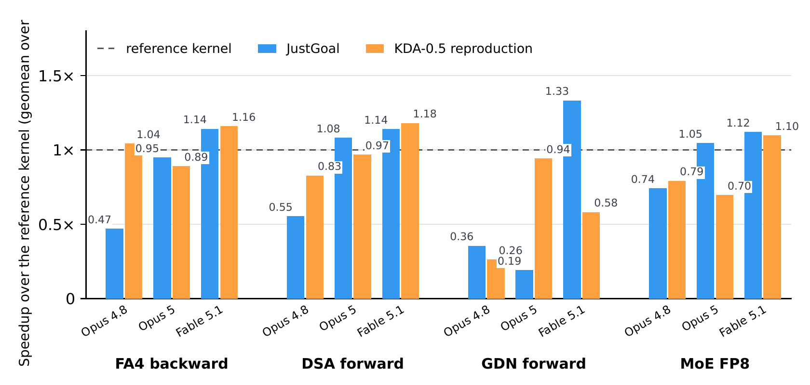

<div align="center">

# JustGoal: With Only a Goal, the AI Baseline Is Above the Expert Kernels

**只给通用 agent 一个优化目标，在 NVIDIA B200 上写出的 GPU 算子**

[English](README.md) | **中文**

[](paper.pdf)
[](#仓库结构)

[](LICENSE)
[](https://github.com/OpenBMB/JustGoal-With-Only-a-Goal-the-AI-Baseline-Is-Above-the-Expert-Kernels/stargazers)
[](https://github.com/OpenBMB/JustGoal-With-Only-a-Goal-the-AI-Baseline-Is-Above-the-Expert-Kernels/issues)



<sub>单 shape JustGoal 与 KDA-0.5 复现（整个定义）在四个算子上跨三代模型相对参照算子的加速比；
每根柱子是该算子各 shape 的几何平均，虚线为参照算子。</sub>

</div>

本仓库发布论文
[*JustGoal: With Only a Goal, the AI Baseline Is Above the Expert Kernels*](paper.pdf)
中生成的算子（kernel）代码。JustGoal 只给通用 agent 一个优化目标和约束，不预先配置任何算子专用的
评测设施、知识库或搜索工作流；agent 自己搭建评测循环并迭代优化实现。在 NVIDIA B200 上，JustGoal
在参与比较的 **10 个算子中的 8 个**上超过开源库，逐算子几何平均加速比为 **1.14–2.34×**；在有公开
专用 kernel agent 算子的 9 个算子中，有 **5 个**超过其中最快的实现。在 **Fable 5.1** 单 shape
的同模型对比中，KDA-0.5 harness 的性能是 JustGoal 的 **0.95×**。

## 仓库结构

| 目录 | 内容 |
|-|-|
| [`goal_single_shape/`](goal_single_shape/) | 指定单个 shape 的 `/goal` 实验 |
| [`goal_full_shape/`](goal_full_shape/) | 覆盖算子定义全部 shape 的 `/goal` 实验 |
| [`kda05_reproduction_full_shape/`](kda05_reproduction_full_shape/) | KDA-0.5 设定下的实验 |
| [`kda05_reproduction_single_shape/`](kda05_reproduction_single_shape/) | KDA-0.5 设定下指定单个 shape 的实验 |
| [`ablation/`](ablation/) | 消融实验 |

各目录统一按 `<模型>/<算子>/<shape>/` 组织。覆盖全部 shape 的目录中，shape 这一层是
flashinfer-bench 的 definition；`kda05_reproduction_full_shape/` 再下一层是各个发布版本，
`ablation/` 再下一层是各个消融变体。`goal_full_shape/`、
`kda05_reproduction_full_shape/` 和 `kda05_reproduction_single_shape/` 中的算子附带
[flashinfer-bench](https://github.com/flashinfer-ai/flashinfer-bench) 的 `solution.json`。

## 环境

- GPU：NVIDIA B200（`sm_100a`）
- CUDA：13.0（`nvcc` 13.0.88，驱动 580.105.08）。有两个算子指向 CUDA 13.1 工具链：
  `goal_single_shape/opus-5/mla_paged_prefill/b1_q33_kv34` 和
  `goal_single_shape/opus-5/gqa_paged_decode/b16_kv2841`。
- CuTe DSL（`nvidia-cutlass-dsl`）：4.6.2。`kda05_reproduction_full_shape/` 和
  `kda05_reproduction_single_shape/` 中的 DSA、GDN、MoE 算子使用 KDA-0.5 设定钉住的 4.6.0。

## 参与贡献

欢迎提 Issue 和 Pull Request，特别是结果错误或编译失败的报告，以及在其他 B200
环境上的复测结果。

## 引用

<details>
<summary>BibTeX</summary>

```bibtex
@misc{chen2026justgoal,
  title  = {JustGoal: With Only a Goal, the AI Baseline Is Above the Expert Kernels},
  author = {Chen, Yaojian and Peng, Dazhi and Zhu, Zhui and Li, Leshan and Sun, Haojun
            and Zheng, Yiyun and He, Qingfeng and Li, Shangzhan and Deng, Xianglong
            and Shen, Yifei and Xiang, Shengye and Li, Zhen and Gan, Lin and Li, Yuxuan
            and Han, Xu and Liu, Zhiyuan},
  year   = {2026},
  howpublished = {\url{https://github.com/OpenBMB/JustGoal-With-Only-a-Goal-the-AI-Baseline-Is-Above-the-Expert-Kernels}}
}
```

</details>

## 许可证

本仓库采用 [Apache License 2.0](LICENSE)。改编自 NVIDIA CUTLASS 示例的文件保留其
BSD-3-Clause 头部和许可，清单见 [`NOTICE`](NOTICE)。

## 致谢

本工作基于 [FlashInfer](https://github.com/flashinfer-ai/flashinfer)、
[flashinfer-bench](https://github.com/flashinfer-ai/flashinfer-bench) 与 MLSys 2026
竞赛 workload、[FlashAttention](https://github.com/Dao-AILab/flash-attention) 以及
[CUTLASS / CuTe DSL](https://github.com/NVIDIA/cutlass)。

本工作来自[清华大学](https://www.tsinghua.edu.cn/)、[面壁智能](https://modelbest.cn/)、
[哈尔滨工业大学](https://www.hit.edu.cn/)和[中国科学院大学](https://www.ucas.ac.cn/)。
